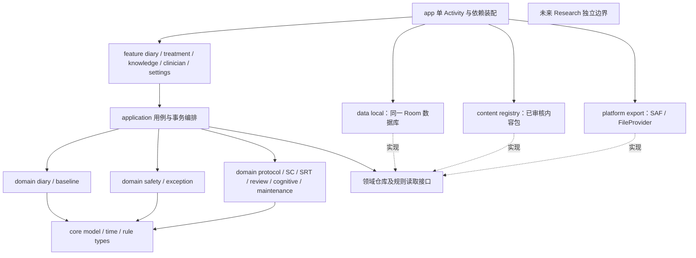
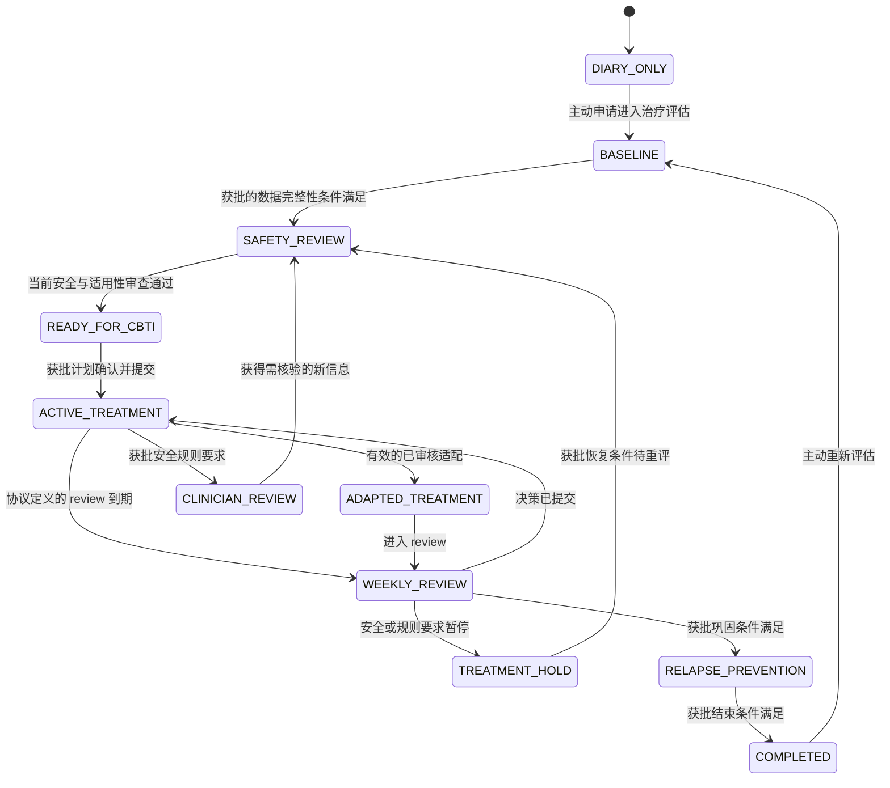

# SleepDiary 完整版架构总览

## 当前执行合同：ARCH-FULL-0.2 / 2026-09-22

当前实现基点为 `f6a815f`（代码 `a122460`）：App / SPEC 0.2.2、Room 5、BACKUP_2.1、CBT-I Protocol NONE。用户最新的 [完整实施 Brief](FULL_APP_IMPLEMENTATION_BRIEF.md) 已授权按 Phase 0–12 持续推进，因此下方历史 ARCH-FULL-0.1 中的 Room 2、BACKUP_1.1 及“文档后停止”仅代表 2026-09-11 当时状态，不再描述当前工程。

当前工程合同由 [差距分析](FULL_APP_GAP_ANALYSIS.md)、[状态机](FULL_APP_STATE_MACHINE.md)、[数据合同](FULL_APP_DATA_CONTRACT.md)、[需求矩阵](FULL_APP_REQUIREMENTS_MATRIX.md) 和 [中断恢复入口](FULL_APP_WORKING_CONTEXT.md) 组成。它们覆盖下方同主题历史提议，但不改变根目录冻结的日记、安全和中性周报语义，也不把工程设计当成医学审核。

完整版保持四个相互隔离的平面：Data Plane 保存原始与不可变业务事实；Treatment Control Plane 执行 Baseline → Metrics → Safety/Exception → Protocol Candidate → Preview/Confirmation → Transactional Commit；Education Plane 只影响学习呈现；External Bridge Plane 只提供用户主动选择的医生或外部 AI 出口。Education、External AI 和未来 Research 都没有治疗状态写权限。

状态使用 Brief 指定的 17 个持久状态，TreatmentMode 独立；安全限制集合、本机执行有效性和用户暂停意愿不能被单一枚举覆盖。所有状态写入由同一控制器完成。日记始终可用，未成年人只被排除在成人治疗算法之外，不删除其既有本地日记能力。

VA Manber 2014 是唯一 PROTOCOL_PRIMARY，VA/DoD 2025 负责安全覆盖，AASM 2021 只负责证据验证，中国来源只作语言和本地情境交叉核对。未明确的有效日、治疗指标、Safety/Exception 映射、恢复条件和时间语义标为 MEDICAL_RULE_BLOCKED，只阻断对应自动路径。SNQ 不复制或重构；依赖它的自助周调整保持权利门控。

首次新增治疗业务数据时采用显式 Room 5→6 和 BACKUP_3.0；之后新增持久集合时继续明确升级，不能等到 Phase 11 才保护已保存数据。激活后的计划业务字段不可变；状态变化使用追加事件与 episode 当前指针。旧备份恢复保留历史但刷新本机恢复代次，不能授予执行权限。

Phase 0 已提交。Phase 1 已实现持久 episode/audit、非处方状态控制器、不可变 plan 领域骨架、Room 6 和 BACKUP_3.0；所有医疗转换仍失败关闭，详见 [Phase 1报告](FULL_APP_PHASE1_REPORT.md)。V4 原生集成继续 SOURCE_NOT_AVAILABLE；现有六条学习短文不能冒充 V4。下一步 Phase 2 只在来源明确处实现治疗指标和基线，其余保留 MEDICAL_RULE_BLOCKED。

## 历史 ARCH-FULL-0.1（保留审计；同主题以上述当前合同为准）

架构草案：`ARCH-FULL-0.1`，2026-09-11。用途：后续分阶段实施的工程设计，不是已批准的医学操作规程，不取代根目录冻结规格。

当前运行版本仍为 SPEC-0.1.2 / App 0.1.0 / DIARY_1.0 / SAFETY_1.0 / SAFETY_RULE_1.0 / WEEKLY_1.0 / BACKUP_1.1 / CBT-I Protocol = NONE / Room 2。本轮只新增规划文档，不启用治疗，不改版本、数据库、APK 或冻结文件哈希。

## 1. 规划文档入口

| 文档 | 负责的问题 |
|---|---|
| 本文 | 现状对照、模块、依赖、页面、数据流与整体状态机 |
| [Protocol 架构](CBTI_PROTOCOL_ARCHITECTURE.md) | 主协议规则、可重放决策、SC/SRT/周 review/认知/维持模块 |
| [Exception 架构](EXCEPTION_ROUTER_ARCHITECTURE.md) | 持续安全覆盖、现实场景、规则缺失与冲突处理 |
| [Knowledge 架构](KNOWLEDGE_AND_EVIDENCE_ARCHITECTURE.md) | 五层来源、审核、统一知识、外部 AI 模板边界 |
| [医生桥接](CLINICIAN_BRIDGE_ARCHITECTURE.md) | 摘要、主动披露、人工指令、权限与审计 |
| [数据与迁移](FULL_APP_DATA_AND_MIGRATION.md) | 新增实体、独立版本、旧数据和备份兼容、事务 |
| [实施路线](FULL_APP_IMPLEMENTATION_ROADMAP.md) | 开发顺序、验收门槛、医学待确认清单 |

## 2. 现有 V0.1 的真实基础

审阅基点：Git `0fe44bb1b99367519a6d3c7a7ca51d34c24a6eb2`。范围为主项目冻结规格、主 Android 工程及其生产代码、测试、Room/备份 schema、示例和既有交付记录；生成目录不是新的规格来源。未提交的 `meditation/` 是独立项目，未并入本方案，也不把其计时器视为获批 CBT-I 放松内容。

现有单 `:app`、单 Activity，Kotlin + Compose Material 3 + Room；数据库有 Diary、SafetyAssessment、SafetyAnswer、WeeklySummarySnapshot、AppState 五张业务表。日记是八个核心构念及可选 comment，保存通过事务、逐字段回读和提交后验证。已提供历史编辑、安全问询、7 天中性总结、JSON 替换恢复、CSV 和白名单 PNG 分享。

| 现有实现 | 可复用资产 | 完整版必须补的边界 |
|---|---|---|
| DiaryRepository、DiaryValidator | 原始值、UUID、时间/数值校验、确认式 warning、事务 | 治疗派生数据另建，不能把不一致估计静默修正成治疗输入 |
| SafetyGateCalculator、SafetyRepository | SAFETY_RULE_1.0 三种 gate、答案和 DRAFT 持久化 | 三种 gate 不是治疗准入；部分答案也可能返回 NO_MAJOR_FLAG，不能据此认定低风险 |
| WeeklySummaryRepository / Calculator | trackingStartDate 冻结、7 日历天周期、均值、revision | 这是日记总结，不是治疗 review；不存在 30 天月报；不能改 WEEKLY_1.0 来加入治疗计算 |
| 历史 snapshot 与 UUID 关联 | 旧汇总值和 revision 被保留 | UUID 不能还原修改前的原始字段；未来须保存不可变决策输入快照 |
| BackupCodec / Repository / SchemaValidator | 1.0/1.1 兼容、校验、预览、全库事务恢复 | 当前仅覆盖五表/固定版本，未来必须显式扩展版本分派和完整恢复集合 |
| DiaryShare、SAF 流程 | 用户主动导出、content URI、临时读权限 | 日记 PNG 继续排除 comment/Safety；医生摘要是不同的受控披露产品 |
| SleepDiaryApp、DiaryViewModel、SavedStateHandle | 表单恢复、导航、退出、现有交互 | 拆分应用编排和功能状态；UI page enum 不能兼任治疗状态机 |
| SafetyContent / MethodsScreen 等 | 已有解释及来源入口 | 目前内容分布多处，未来逐步由统一 Registry 提供、审核后替换 |

历史验证边界以 [S24 报告](S24_DEVICE_VERIFICATION.md) 为准：既有 230 个 JVM 测试结果通过；真机 instrumentation 6/7，通过的项目包括 30 天记录、7 天周报、备份往返及回滚、CSV、PNG 文件与 URI。中文 IME 自动化仍有一项失败，完整 Sharesheet 向第三方交接未完成验收。本轮不重跑测试，也不将“数据库关闭重开”写成已验证全部进程崩溃情况。

## 3. 产品和医学来源职责

定位是离线优先、可追溯、分阶段、能把需要临床判断的情况交给医生的 CBT-I 辅助系统。V0.1 继续作为独立可用日记；未参加治疗、治疗暂停或技术检查失败都不应阻断日记。

| 层 | 指定来源 | 决策权限 |
|---|---|---|
| 测量 | 当前采用的 Consensus Sleep Diary | 原始构念、主观估计；不决定治疗窗口 |
| 操作 | VA CBT-I Therapist Manual | 经逐条审核后的唯一主操作规则集；确切版本及适用范围待锁定 |
| 安全覆盖 | VA/DoD 2025 Insomnia/OSA Guideline | 经审核的适配、暂停、临床参与等约束优先于普通治疗 |
| 证据验证 | AASM 已正式发表指南、获准纳入的 SR/RCT | 说明证据和局限；不抽取其他阈值拼接主协议 |
| 本地化 | 《失眠症数字疗法的中国专家共识（2024版）》 | 中文教育、支持和就医路径交叉验证；不替换 VA 参数 |

来源检索、准确链接及本轮没有完成的全文临床审核见 [Knowledge 文档](KNOWLEDGE_AND_EVIDENCE_ARCHITECTURE.md)。选定来源不等于已允许完全自助治疗；`self-guided` 与 `clinician-assisted` 的人群、适应条件必须另行审核。

## 4. 十六个逻辑模块

| 模块 | 职责和持久化产物 | 不允许做的事 |
|---|---|---|
| Sleep Diary Core | 原始记录、现有历史与中性周报 | 自动诊断、改写原始值、单夜评分 |
| Baseline Assessment | 独立评估、缺项、来源和评估时点 | 复用 comment 为隐式问卷；把投诉类型标成确诊 |
| Safety Router | 持续观察、规则匹配、有效约束和重评要求 | 用 NO_MAJOR_FLAG 直接放行新治疗 |
| Protocol Engine | 确定性疗程编排、版本化 proposal/decision | UI/LLM 计算或缺规则时猜测 |
| Stimulus Control | 主协议 SC 任务、解释和用户反馈 | 夜间“20 分钟”倒计时 |
| Sleep Window / SRT | 获批的窗口/固定起床/TIB 计划 revision | 把观察 TIB 与处方 TIB 混用 |
| Weekly Review | 独立 review 周期、输入、调整或延期决策 | 根据单夜指标机械调整 |
| Cognitive Therapy | 信念 profile、思维记录、行为实验、复习 | 未许可量表、自动精神诊断 |
| Education | 小卡片、场景题、按需“为什么” | 另存一套医学规则或频繁打扰 |
| Exception Router | 情境→审核规则→有限范围/时效的处理 | 无来源的生活“允许/禁止”清单 |
| Lifestyle / Context | 可选情境、时间线和主观影响 | 新增每日结构化医学字段到 DIARY_1.0 |
| Clinician Bridge | 主动选择的摘要、问题、人工指令留痕 | 自动确诊、把用户录入冒充已核验医嘱 |
| Evidence & Traceability | 来源版次、知识节点、规则依据和审核 | DOI/引用存在就视为可执行 |
| Import / Export / Privacy | 各用途白名单、全库恢复、同意和缓存 | 自动上传、暗中公共目录备份 |
| Maintenance / Relapse | 经审核的巩固、复习和再评估流程 | 复发后直接重启旧窗口 |
| Research（未来） | 隔离研究数据和权限 | EEG/穿戴/Health 数据进入治疗依赖图 |

## 5. 工程模块和依赖方向

16 个逻辑模块不等于立即创建 16 个 Gradle 工程。先在单 app 中分离接口、用例和 ViewModel，保持行为；形成稳定边界后再拆以下模块。暂不增加 DI 大库。

领域层纯 Kotlin，只接收不可变 DTO、时钟/日历策略和规则接口，不引用 Compose、Activity、Room entity 或网络。当前领域层与 entity 的耦合通过适配 DTO 渐进迁移，不能一次重写可靠的 Diary 保存逻辑。Safety 不依赖 UI 或具体 SRT 实现；Protocol 接收 Safety 约束，不能回调“降低”约束。Exception 可提出受限适配候选，最终必须再次经过安全合并。

`application` 负责事件顺序、幂等、版本校验和原子提交。`data:local` 拥有同一 Room 数据库及跨表事务，避免核心治疗与 Diary 分库造成半成功。Research 未来独立存储/工程边界，当前不实现，也不让其成为核心构建必需项。

## 6. 核心数据流与并发

```mermaid
flowchart LR
    User[明确确认的用户输入] --> Save[校验并事务保存原始数据与待处理事件]
    Save --> Snapshot[不可变输入快照与版本水位]
    Snapshot --> Gate[最新 Safety 与缺项检查]
    Gate --> Evaluate[固定版本 Protocol / Exception 计算候选]
    Evaluate --> Merge[合并约束与有效人工指令]
    Merge --> Preview[解释和用户确认]
    Preview --> Recheck[再次核对安全水位及状态 revision]
    Recheck --> Commit[原子提交 decision / plan / state / audit]
    Commit --> UI[UI 只渲染已提交且仍有效的输出]
```

1. Diary 保存仍按原事务和回读契约执行；未来同事务登记轻量待处理事件，不在 Diary 保存事务内执行完整治疗引擎。
2. 事件消费者用幂等 command ID，捕获原始输入内容、版本、时间和哈希；数据库重开后可恢复未处理事件，不依赖后台定时器常驻。
3. Proposal 绑定 `expectedStateRevision`、`inputSnapshotId`、`safetyWatermark` 和 bundle hash。确认期间新增 Safety 事件、编辑日记或更新有效人工指令，必须作废旧 proposal 后重算，不能提交过期窗口。
4. 输出、计划、疗程状态和审计在一个 Room 事务中写入并回读。提交后读取失败须显示“结果尚未验证”，重试同 command 查询结果，禁止再加一次 revision。
5. 已存 Diary 不因治疗计算失败回滚；治疗 unavailable 与保存失败分别表达。已确认的安全输入应优先持久化；写入失败时仍可显示静态帮助入口，但不能宣称安全评估已保存或通过。
6. 不能用自由 comment、设备数据、AI 返回或网络内容自动产生规则输入；只能使用用户明确提交的结构化情境与已验证来源。

## 7. 治疗状态机

持久化分三轴：`TreatmentPhase`（进度）、`SafetyRestrictions`（约束集合）、`OperationalReadiness`（规则/输入/恢复校验是否可用）。UI 展示态由三者投影，不能用单一 enum 大小决定临床优先级。

图中条件是审核槽位，不是已设定的临床判断。Safety/Exception 可从任何阶段施加限制，图未重复画出所有覆盖箭头。保存 `resumePhase` 仅用于审计，不表示解除限制后自动恢复旧计划。

`ADAPT` 与 `CLINICIAN_REVIEW` 可同时存在；`SAFETY_OVERRIDE` 表示覆盖来源而不是疾病严重度；`URGENT_CARE` 是经审核的行动路径，不是 App 诊断的风险等级。安全要求优先，治疗只能在约束交集内执行；相互矛盾或关键规则缺失时，技术状态阻止新治疗指令并保留日记。恢复、重新入组、解除 hold 均需独立 guard 和审计，不能靠重启 App 清除。

## 8. 页面与低负担交互

主入口保留日记；加入自愿进入的“我的疗程”、按需“理解与帮助”和设置。每天以短日记与必要任务为主，知识按阶段少量出现，不新增打卡、睡眠评分、单夜好坏、通知轰炸。

| 页面组 | 页面与返回关系 |
|---|---|
| Diary | 日记→保存结果；历史→详情→编辑→原日期；现有 comment 和估计交互保留 |
| Baseline | 评估说明→分段回答/保存进度→缺项摘要→安全重评→治疗方式确认 |
| Treatment | 当前有效计划→为何这样→来源；SC/SRT/认知/放松任务与短反馈 |
| Review | 周期范围与缺项→依从/日间状态/情境→决策解释→确认；不沿用日记周报弹出逻辑 |
| Exception | 主动描述情境→必要的已审核问题→可执行范围/联系医生；保留回到原入口 |
| Clinician | 时间范围与字段预览→本地展示/主动导出；人工意见录入→核对→适用性审查 |
| Settings | 历史、备份、隐私、方法、术语、版本、当前问询；所有内部子页有返回 |
| Evidence | 方法与依据解释来源角色和局限；版本页展示运行/内容版本，二者相互链接但不是同页 |

用带 origin 的类型化路由区分首启、设置、治疗入口。表单临时态用 ViewModel/SavedStateHandle；需要备份恢复的已保存业务状态进入 Room。临时 picker 位置不作答；中断/重建不得把默认值污染为业务答案。

## 9. 本轮落点

这是可实施的工程架构草案。临床参数、适用人群、例外规则和临床审核责任尚未补齐，不能从本文直接启用治疗。下一步顺序与必须由人确认的事项集中在 [实施路线](FULL_APP_IMPLEMENTATION_ROADMAP.md)。本轮完成文档后停止。
