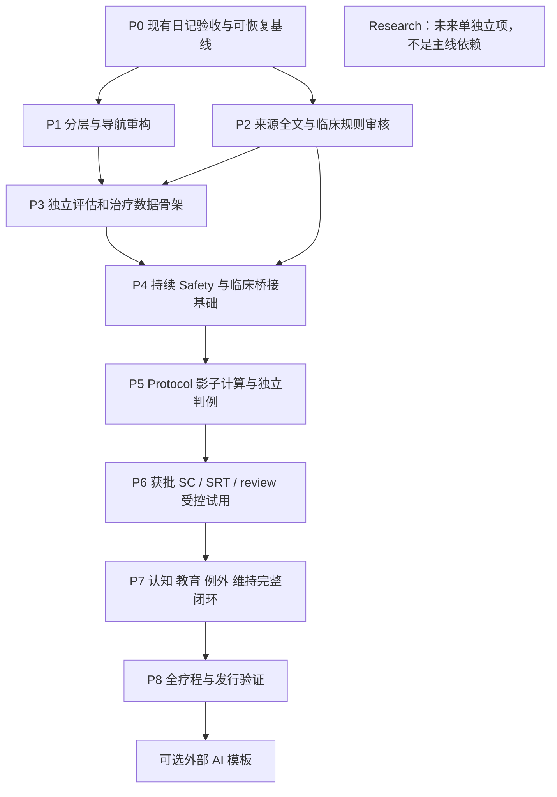

# 完整版分阶段实施与审核门槛

`ARCH-FULL-0.1` 工程草案，2026-09-11。当前交付是架构规划，**完成本文档后停止，不自动进入任何实现阶段**。文档入口：[FULL_APP_ARCHITECTURE](FULL_APP_ARCHITECTURE.md)。

## 1. 推荐顺序

临床内容审查可以与无临床行为的工程准备并行推进；依赖未满足的治疗分支不能先以猜测规则运行。所有工作优先本机、固定稳定依赖、明确小提交，不创建远程、不自动 push。

这里 P0–P8 是路线阶段编号，不替代冻结 TEST_PLAN 中 P0 测试优先级。

| 阶段 | 可实施范围 | 开始所需条件 | 退出门槛与交付 |
|---|---|---|---|
| P0 保护现有基线 | 补齐未验收 IME、Sharesheet、真实进程/生命周期场景；核对签名/备份与重装风险 | 当前 V0.1；真实用户库不能作为破坏性测试库 | 既有 P0 场景逐项映射，未执行项不写 PASS；隔离库与用户主动操作边界清楚；可用旧 APK/备份路径留档 |
| P1 结构拆分 | typed routes、分离 ViewModel/用例、纯领域 DTO、依赖检查；先保留单 app | P0 基线；不修改医学/数据行为 | 所有现有测试及构建、S24 关键交互回归；旧 JSON/CSV/PNG 字节/语义契约保持；可单独审查的重构 commit |
| P2 医学与知识底座 | 来源全文/版次、许可、主张/规则 Registry、规则提取矩阵与审核流程 | 指定来源可取得；明确临床审核人 | 每条拟发布规则有出处、适用性、中文解释、签字、独立金标准；不要求一次审完目录所有未来场景，但未审内容不能发布 |
| P3 新数据骨架 | 新 Baseline/Context/Treatment/Audit/Snapshot 表，规则包归档、事务/幂等框架、新备份兼容 | 对应题干/数据语义和新版本规格已批准；空壳技术框架可先做 | Room 无损迁移和三代备份测试，原五表不变，旧安装保持 DIARY_ONLY；导出范围覆盖全部新增恢复对象 |
| P4 持续安全 | 获批新评估入口、事件、约束合并、hold/复核、基本医生摘要；Exception 框架 | M01/M02/M06/M07/M09/M10 的本阶段必要部分已解决 | 独立安全判例通过；所有入口及恢复无法绕过安全，日记始终可用；未支持场景不伪造规则 |
| P5 Protocol 影子验证 | 纯计算、输入快照、trace、review 日历、版本 pin；只用合成/授权测试数据 | 操作规则、指标和适用性审核完成 | 与临床独立判例逐条一致，边界/并发/恢复/错误输出测试通过；不向真实用户展示试验窗口 |
| P6 受控治疗闭环 | 获批 SC+SRT、固定起床、review、必要教育及 Safety/Exception 路径 | 规则与安全路径完整；试用对象和临床责任明确 | 受控可用性/临床监督验证；计划解释、变更、暂停/恢复可追溯；自助开放须额外满足适用性审核，不能从内部试用直接推广 |
| P7 完整疗程 | 认知/行为实验/放松、逐步扩充获批现实场景、医生指令、巩固/复发预防 | 每个子模块医学与许可审核完成；必要安全例外在 P6 前已有可用路径 | 全疗程和中断恢复贯通；不靠每天高频交互维持；缺失内容清楚禁用；临床指令冲突和审计验证 |
| P8 发行验证 | 完整回归、升级、备份、隐私、无障碍、长期生命周期、目标人群与临床验证 | 核心闭环完成且未解决安全问题已关闭 | 发布范围/宣称、支持方式、内容复核及责任落实；稳定版本签名与数据升级演练；临床/合规审核另行完成，不能只凭构建绿灯发行治疗功能 |

外部 AI 模板可在核心系统验证后单独批准实现，不作为治疗上线前提。Research、穿戴、Muse、EEG、Health API 不进入本轮或主线依赖；未来另建医学/隐私/数据协议，不自动用于治疗判断。

## 2. 必须由人确认的医学和治理事项

用户确认产品方向，具备相应能力的临床审核者确认具体规则及适用性；工程代理负责整理证据和实现已确认规则，不能替代临床签字。以下不阻碍架构文档交付，但阻碍对应临床功能发布。

| ID | 必须补齐的内容 | 未解决时的限制 |
|---|---|---|
| M01 主来源与人群 | VA 手册确切版次/章节，全文提取；从治疗师/退伍军人场景到目标用户和离线软件的适用性；self-guided / clinician-assisted 准入 | 不能启用自动治疗或把现有 gate 当低风险许可 |
| M02 Baseline | 最低日记天数、有效日标准、必要问询/量表及版权、缺项/过期处理；投诉模式与诊断边界 | 可设计框架，不能决定已满足治疗条件 |
| M03 治疗指标 | TST/SE 具体定义、分母、终末清醒/午睡、误差/不一致估计、有效样本及舍入 | 不计算治疗指标；不更改原始 DIARY 或 WEEKLY_1.0 |
| M04 初始窗口 | 初始 TIB/窗口、上下限、sleep need、固定起床协商及全部等号边界 | 不向用户产生初始窗口 |
| M05 Review 与调整 | 真实周期、最少有效数据、依从/睡意/事件的联合作用、调整步长/阈值、保持/延期/暂停、迟到数据与停疗周推进 | 不根据 SE 或单夜自动调整 |
| M06 Safety 覆盖 | 每个触发与 CONTINUE/ADAPT/HOLD/CLINICIAN_REVIEW/URGENT_CARE 的具体映射；重评时效、冲突、恢复条件 | 现有 SAFETY_RULE_1.0 可用，但不能作为新治疗路由的替代 |
| M07 Exception 与 safety nap | 所有拟上线场景的来源、适用范围、时长/时点/终止/复核；未知场景/共病安全边界 | 仅目录与待审核标记，不给临时医学例外建议 |
| M08 SC/认知/放松/维持 | 精确任务和中文解释、特殊情境适配、量表/练习许可、间隔复习、结束/复发再评估条件 | 不发布未经审核的治疗内容或行为实验 |
| M09 临床指令 | 谁可授予哪种 override，如何核验身份/来源、作用范围、撤销/过期/冲突，用户转述的权限 | 只可存沟通记录，不让原文解锁治疗 |
| M10 本地安全与支持 | 中国就医/紧急帮助渠道、地区适用、可达性；人工支持责任、不可自动化情境处理 | 不虚构当地帮助号码或承诺人工实时响应 |
| M11 时间语义 | 治疗跨午夜、旅行/夏令时/倒班、窗口日历及 review 日期归属与特殊人群适配 | 保留旧墙钟语义；复杂场景不自动平移窗口 |
| M12 临床验证与发布责任 | 临床审核人/流程、目标人群试用、效果与安全验证、治疗宣称与发行范围；不能将规划本身视作授权 | 不宣称已是经验证的数字疗法或可直接用于所有用户 |

涉及公开发行的具体监管/法律结论，应在目标市场确定后另行核查；本方案不作此类结论。

## 3. 规格演进方式

当前七份架构文档使用独立 DRAFT 标记，不加入冻结 SPEC_MANIFEST，也不把 SPEC 自动升级。实施 P3 及后续治疗行为前，提出相应新版本的增量规格、JSON Schema、例子、迁移和测试计划，用户批准后冻结。

Diary 继续 DIARY_1.0，旧 Safety/Weekly 的历史解释继续保留；新评估、治疗、指标、Exception、Knowledge 分别版本化。BACKUP_2.0 只是结构扩充时的建议下一格式，当前导出仍 BACKUP_1.1。医学规则/备份结构/内容勘误分别追溯，不借 App 小版本号掩盖变化。

临床事项未解决时可继续不依赖它的工程框架、文档和测试工具；不得以“先写默认值以后改”为由越过审核。本轮不继续这些实现。

## 4. 持续验证与交付标准

每个代码阶段都执行本机 `gradlew.bat testDebugUnitTest`、`gradlew.bat assembleDebug`，需设备的测试独立报告实际结果。检查 merged Manifest 无 INTERNET / ACCESS_NETWORK_STATE / MANAGE_EXTERNAL_STORAGE；不得增加云/遥测依赖。

| 验证层 | 要点 |
|---|---|
| 既有回归 | 原八字段、comment 输入/历史编辑、DRAFT、日记周报、SAF、PNG/CSV/JSON 隐私 |
| 纯规则 | 临床独立判例、单位、边界、缺项、冲突、确定性、版本兼容 |
| 数据可靠性 | 全路径迁移、完整 round-trip、replace 回滚、不可变快照、幂等、并发安全水位 |
| Lifecycle | Activity 重建、旋转、真实进程终止/重启、review 提交中断、恢复中断、分享交接 |
| UI/理解 | 中文 IME、48dp、TalkBack/大字体、未答无默认、为什么可追溯、设置/治疗各入口返回 |
| 隐私/信任 | 导出白名单、未知规则包拒绝执行、医生原文不当脚本、外部 AI 无回写、Research 无治疗依赖 |
| 临床验收 | 目标人群和适用性、内容审核、人工支持、完整安全与例外路径、受控使用反馈 |

测试隔离数据库及合成案例，不清空真机用户库。主动替换恢复和真实第三方分享应在明确选择的数据/目标上操作；不可把“调试授权”当成任意披露自由文本的授权。

每阶段一个可审查的变更范围，提交说明记录实际测试、尚未验证项、迁移和回退能力。代码正确性与临床正确性分别验收。已有通过且无相关修改的测试不无意义重复，但阶段最终构建和要求的相关测试不省略。

## 5. 本轮完成与下一步

本轮新增七份相互链接的架构文档，保留原代码、版本、Schema、冻结规格和 APK。核验文档链接、JSON 示例语法、Git diff 以及冻结清单的 SHA-256/字节数；文档变更不需要重新编译 APK，不把历史测试当成本轮新执行结果。

推荐下一轮先确认架构方向，再执行 P0/P1 的日记基线与工程分层，同时组织 P2 的确切手册及医学规则审核。只有相应医学和数据规格批准后，才逐步开放后续治疗实现。
