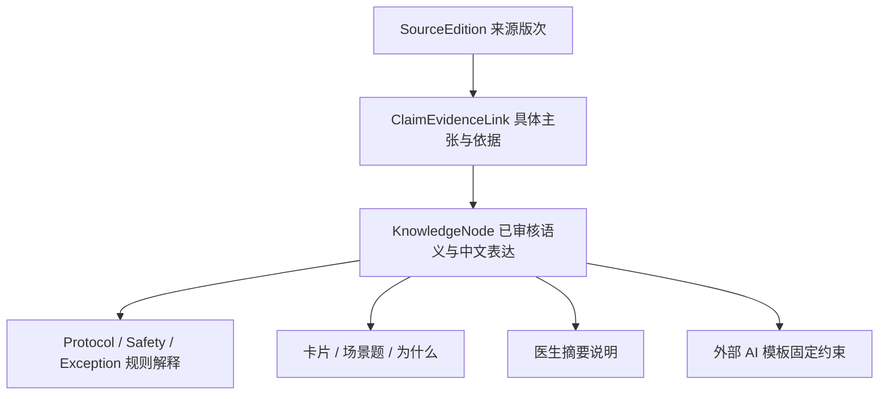

# 统一 Knowledge / Evidence Registry

`ARCH-FULL-0.1` 工程草案，2026-09-11。关联 [总览](FULL_APP_ARCHITECTURE.md)、[Protocol](CBTI_PROTOCOL_ARCHITECTURE.md)、[Exception](EXCEPTION_ROUTER_ARCHITECTURE.md)、[医生桥接](CLINICIAN_BRIDGE_ARCHITECTURE.md)。不替换冻结 EVIDENCE.md，不宣称本轮完成所有医学全文审查。

## 1. 来源身份与本轮核验范围

| 稳定来源 ID（规划） | 中英文名称/版次与链接 | 负责层与本轮限制 |
|---|---|---|
| CSD_CORE_2012 | Consensus Sleep Diary / 共识睡眠日记，Carney 等，2012；[原始论文](https://pubmed.ncbi.nlm.nih.gov/22294820/)，DOI 10.5665/sleep.1642 | 沿用冻结项目测量来源；不据此引入新每日构念或治疗规则 |
| VA_CBTI_MANUAL_2014_CANDIDATE | Cognitive Behavioral Therapy for Insomnia in Veterans: Therapist Manual / 退伍军人失眠认知行为治疗：治疗师手册，Manber 等，2014；[VA 官方 PDF](https://www.mirecc.va.gov/visn19/treatmentworksforvets/docs/CBT-I-Therapist-Manual.pdf) | 用户选定主来源后的候选确切版次；官方索引已核对，工具因 PDF 大小未成功完整打开，未做逐页提取、页码锁定或本地文件哈希；须补全文审核 |
| VA_DOD_IOSA_2025 | VA/DoD Clinical Practice Guideline for the Management of Chronic Insomnia Disorder and Obstructive Sleep Apnea；Version 3.0–2025；[官方入口](https://www.healthquality.va.gov/HEALTHQUALITY/guidelines/CD/insomnia/index.asp)、[官方完整 PDF](https://www.healthquality.va.gov/HEALTHQUALITY/guidelines/CD/insomnia/I-OSA-CPG_2025-Guideline_final_20250915.pdf) | 官方 PDF 可访问，182 页，封面为 January 2025；网址含文件修订日期，不能把它误作另一套协议年份。仅核验身份/定位，不等于本轮完成全部安全规则提取 |
| AASM_BEHAVIORAL_2021 | Behavioral and psychological treatments for chronic insomnia disorder in adults: an American Academy of Sleep Medicine clinical practice guideline / 成人慢性失眠行为与心理治疗指南，Edinger 等，2021；[正式论文](https://pmc.ncbi.nlm.nih.gov/articles/PMC7853203/) | 证据验证；使用正式发表版本，不使用搜索中出现的 2020 征求意见稿来锁规则 |
| CN_DIGITAL_INSOMNIA_2024 | 《失眠症数字疗法的中国专家共识（2024版）》，中华医学杂志，2024，104(9)；[期刊官方目录](https://cs.medjournals.cn/cn/toc/63244)，DOI 10.3760/cma.j.cn112137-20230904-00386 | 核验精确名称/出处，中文全文临床提取待完成。不要与《中国全科医学》另文《失眠数字疗法中国专家共识》混为同一篇 |

上述对来源负责层的划分来自本轮产品要求；“某个具体 Exception 场景被某指南直接支持”需要另外逐项证据，不能从表中推断。手册为治疗师资料，直接转为离线 self-guided 软件所需的人群适用、人工支持及临床验证不能由书目身份代替。

源文件在后续审核阶段获取后保存精确版次、发布日期/修订信息、检索日期、内容哈希、打印页码与 PDF 页序。版权不允许入库的全文只保留合法定位与摘要；官方链接变更不静默覆盖既有 SourceEdition。

## 2. 一份医学内容，多种呈现

Rule 表达的是可执行条件与动作；KnowledgeNode 表达意义、机制和解释。二者互相引用，但自然语言内容不能被 UI/模型解析成算法。不同受众的短文、专业摘要和模板由同一节点产生，经审核的投影可以长度不同，不能持有另一套独立阈值。

## 3. 具体结构

| 对象 | 最低字段与约束 |
|---|---|
| SourceEdition | source_id、titleOriginal、titleChinese、authors、year、edition、publisher、DOI、officialUrl、retrievedAt、fileHash?、rightsStatus、sourceRole |
| EvidenceItem | evidence_id、source_id、studyType、population、intervention/comparator、outcomes、limitations、reviewStatus；SR/RCT 逐篇审批，不自动抓取入库 |
| ClaimEvidenceLink | claim_id、source_id、source_section/page、supportedScope、limitations、evidenceRelation；支持/有限/冲突/未知是证据关系，不是用户风险分级 |
| KnowledgeNode | knowledge_id、version、title、plain_language、clinical_meaning、source_id/sourceRefs、source_section、source_url、protocol_version、risk_level、related_rules、claimRefs、audience、locale、reviewStatus |
| ContentProjection | nodeId/version、surface、approvedText、templateVersion、interactionType、requiredContext、copyrightRef |
| ReviewRecord | review_id、reviewerIdentity/role、reviewedAt、decision、scope、sourceEditionHashes、clinicalSignoff、languageReview、licenseReview、supersedesRef |
| PackageManifest | kind/version、node/rule清单、compatibilityMap、contentHash、reviewManifest、releaseStatus、supportedLocales |

`risk_level` 在 Registry 仅表示内容审核敏感度/需要何种审核，不是患者疾病风险值，不参与 Safety 计算。具体枚举在内容规范阶段确定，避免与分流级别混用。

教育题/行为实验的结构可包含 prompt、用户响应类型、反馈节点及复习策略；医疗反馈须指向获批节点，不通过自由文本评分出诊断。学习进度与疗效评估分离。

## 4. 审核与更新流程

1. 登记准确来源及许可，获取可合法审查的全文；记录版次和页码。
2. 逐条提取主张，标明适用范围、人工判断成分和不确定性。涉及其他指南与主协议不同参数时记录差异，不自行择优混合。
3. 中文临床语义复核，明确目标人群/上下文和必须就医的边界；许可审核与临床审核分别留痕。
4. 生成短卡、场景解释、医生说明和模板投影；自动检查引用完整、版本匹配、同一参数单一来源和缺失翻译。
5. Rule 金标准测试、知识规则一致性检查及人工复核通过后随可信应用内容包发布；核心仍可离线运行。
6. 勘误产生新版本。活动课程采用的包与安全更新策略见 Protocol 文档；旧包保留历史解释。导入备份的内容只归档，不获得执行权限。

确认论文开放访问不等于可以商业复制整篇、量表或全部插图。VA 资料可能含第三方内容；中文翻译、认知量表、练习表各自核对权利。暂不可用的原量表不自创同名计分替代品。

## 5. 用户可追溯界面

“方法与依据”展示：五层职责、双语名称、年份、局限、DOI/官方链接、准确时才展示页码；“版本信息”独立展示 App/SPEC/Diary/Safety/Safety Rule/Weekly/Backup/Protocol/Exception/Knowledge/医学内容复核日期，并链接方法页。复核日期来自实际 ReviewRecord，不能用编译日期冒充。

每条治疗动作的“为什么”展示对应决定的规则和当时版本；历史决定不能用今日修改后的文案掩盖当时依据。无历史内容包时显示缺失，不伪造旧解释。来源链接由用户主动在系统浏览器打开，核心不申请 INTERNET。

## 6. 外部 AI Prompt Bridge（未来可选）

核心不依赖 LLM；不提供模型 API、网络权限、AI 入库解析或治疗回写端口。将来仅可生成用户主动复制的咨询模板：

- 当前已核实的协议/版本；若仍 NONE 或内容不完整就如实写明。
- 该场景涉及的已审核知识及不确定性；禁止诊断、改药、改窗口、覆盖安全规则或发明例外。
- 建议回答顺序：先讨论安全边界，再解释有关原理，再列应向医生核实的问题。
- 默认无个人健康数据；用户逐类选择摘要后预览最终全文，再明确复制。comment、Safety、药物/心理信息各自可见且不默认加入。

这些文字不能约束外部 AI 一定遵守。App 不把 AI 答复读取、验证后“转正”或写回 Protocol Engine，也不将未知高风险场景交给 AI 决定。急性帮助入口优先于模板功能。复制意味着内容离开 App 私有存储，说明系统剪贴板及第三方工具属于外部隐私边界；不记录实际复制的健康原文到调试日志。

测试必须验证模板来源与教育/医生说明一致、默认无敏感内容、取消零复制、未知协议不伪装已启用、没有 AI 回写路径，以及隐私字段白名单不可绕过。
